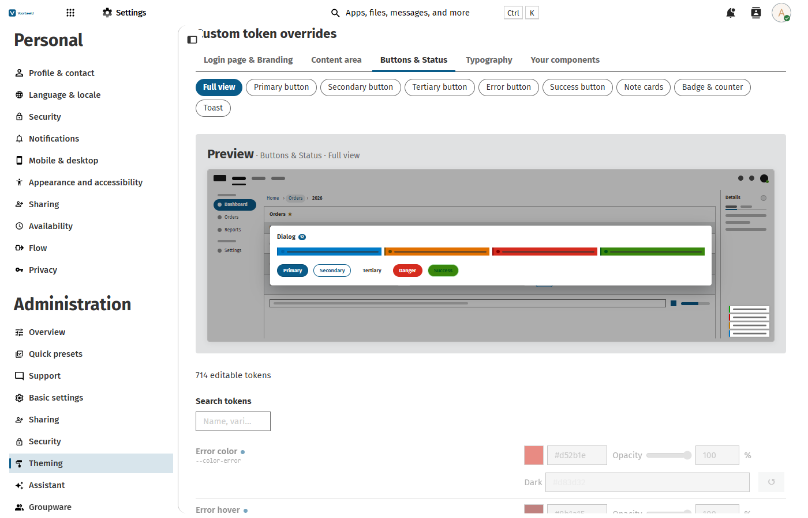

# Fine-tune colours and components

A theme sets hundreds of values. When one of them is not quite right, for example the hover colour of a button, change it in the token editor under **Custom token overrides**. Your changes are kept on top of the theme.

## Step 1 — Find the value

1. Scroll to **Custom token overrides**.
2. Pick a tab: **Login page & Branding**, **Content area**, **Buttons & Status**, **Typography** or **Your components**.
3. Pick a component under the tab, such as **Primary button** or **Note cards**, to see only the values that component uses. **Full view** shows all of them.
4. Or type a name in **Search tokens**, for example *hover*.

## Step 2 — Change it

Each row has a colour picker, a text field for the value and, for colours, an **Opacity** slider. The preview repaints while you change it. The **↺** button at the end of a row puts that value back to the theme's value.

Rows that are greyed out are locked by **Let the primary color drive every component**, further down the page. Switch that option off to give components their own colours.

## Step 3 — Save

Click **Save overrides**. Thematiq asks **Save these overrides?** before it saves; tick one of the **Don't ask before saving…** options to skip that question next time.

## Keep or share your changes

- **Download** saves your overrides as a file; **Upload** loads such a file again.
- **Export as token set** turns the theme plus your overrides into a new theme under **Your custom token sets**.

## Layout options

Further down, after **Custom fonts**, are options that change the layout rather than a colour, such as **Hide Nextcloud slogan/payoff on login page**, **Show text labels in app menu (hide icons)**, **Workplace layout**, **Brand stripe under the top bar** and **Navigation width in pixels**. Most of them start on **Follow the theme**; a choice you make here always wins.

More detail: [Token editor](../features/token-editor.md), [Import and export](../features/import-export.md) and [Display options](../features/toggles.md).
