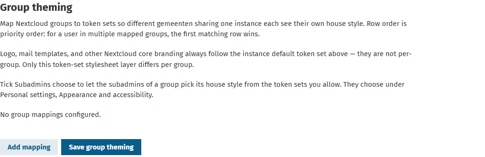

# Groups and apps

## A theme per group

Several organisations sharing one Nextcloud? Give each group its own theme under **Group theming**:

1. Click **Add mapping**.
2. Choose the Nextcloud group and the theme for that group.
3. Add a row for every group. Order matters: someone in more than one mapped group gets the theme of the first matching row.
4. Click **Save group theming**.

Tick **Subadmins choose** on a row to let that group's subadmins pick its theme themselves, from the themes you allow. They do that under **Personal settings → Appearance and accessibility**.

The logo, the emails and the rest of Nextcloud's own branding stay those of the main theme; only the colours and styles differ per group.

## A brand for one app

Under **Brand per app** you can give one app its own theme and logo, for example a knowledge base or a participation platform:

1. Choose the **App** and the **Token set**.
2. Click **Save brand**.

On that app's pages everyone sees the brand; other pages keep the main theme. The app's name in the apps menu stays as Nextcloud shows it.

## Leave an app unthemed

Under **Theming per app**, open the list (it shows, for example, *55 of 55 apps themed*) and untick the apps that should keep Nextcloud's own look. Click **Save app theming**.

More detail: [Group theming](../features/group-theming.md), [Group house style](../features/group-house-style.md), [Brand per app](../features/brand-per-app.md) and [App compatibility](../features/app-compatibility.md).
