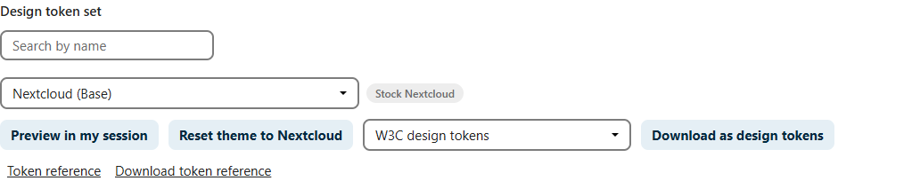

# User manual

These guides walk you through the jobs an administrator does with Thematiq, one task per page. Each step names the buttons and fields exactly as the app shows them in English.

All settings are on one page: open the avatar menu, choose **Administration settings**, then **Theming** in the left column. Scroll past Nextcloud's own theming settings to the **Thematiq** heading.

| I want to… | Guide |
|---|---|
| Give Nextcloud our own colours and logo | [Make your own theme](./make-your-own-theme.md) |
| Use a theme file our designers made | [Upload a theme file](./upload-a-theme-file.md) |
| Switch to a theme and check it before everyone sees it | [Preview and apply a theme](./preview-and-apply.md) |
| Change one colour, a corner radius or a button | [Fine-tune colours and components](./fine-tune-colours.md) |
| Change the fonts or the logos | [Logo and fonts](./logo-and-fonts.md) |
| Give a department or an app its own look | [Groups and apps](./groups-and-apps.md) |
| Brand the emails and documents Nextcloud sends | [Emails and documents](./emails-and-documents.md) |
| Copy our settings from test to production | [Move your settings](./move-your-settings.md) |
| Undo a change, or go back to plain Nextcloud | [Undo and reset](./undo-and-reset.md) |

Never used Thematiq before? Start with [Installing Thematiq](../getting-started/installation.md) and [Choosing your theme](../getting-started/configuration.md).
