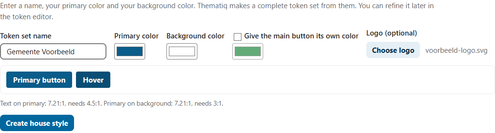
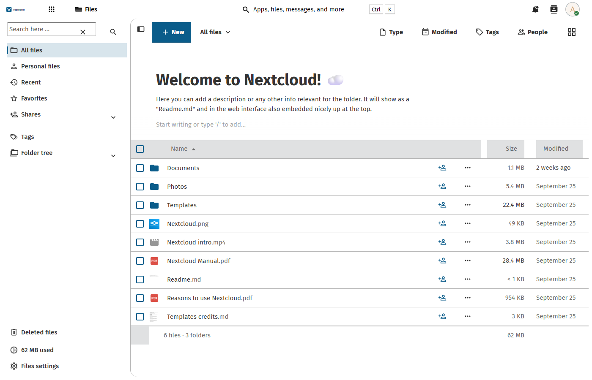

# Make your own theme

Your organisation is not in the list of ready-made themes? Make one from two colours and your logo. Thematiq works out the rest: hover colours, borders, text colours and the login page.

**You need:** your primary brand colour and background colour as hex codes (for example `#0a5c8a`), and optionally your logo as SVG, PNG, JPG, GIF or WebP.

## Step 1 — Open the form

1. Go to **Administration settings → Theming** and scroll to **Custom token sets**.
2. Click the **Start from your colors** tab.

## Step 2 — Fill in your brand

1. **Token set name** — the name you will pick from the list later, for example *Gemeente Voorbeeld*.
2. **Primary color** — the colour of buttons, links and the selected menu entry.
3. **Background color** — usually white (`#ffffff`).
4. *Optional:* tick **Give the main button its own color** when your main button is not in your primary colour, and choose that colour.
5. *Optional:* click **Choose logo** next to **Logo (optional)** and pick your logo file.

The sample buttons under the form (**Primary button**, **Hover**) show your colours straight away. The line beneath them checks contrast, for example *Text on primary: 7.21:1, needs 4.5:1*. When a figure is below what it needs, choose a darker or lighter primary colour, or people with low vision cannot read your buttons.

## Step 3 — Create it

Click **Create house style**. The message *"Gemeente Voorbeeld" is saved and is now in the dropdown. Select it to apply it.* confirms it worked. Your theme is now listed under **Your custom token sets**.

Nothing has changed for your users yet: creating a theme does not apply it.

## Step 4 — Apply it

Pick your theme in the **Design token set** list at the top of the section and confirm with **Apply selected**. [Preview and apply a theme](./preview-and-apply.md) explains that dialog.

## Next steps

- Adjust single colours or components in [Fine-tune colours and components](./fine-tune-colours.md).
- Add your own fonts in [Logo and fonts](./logo-and-fonts.md).
- To change the theme later, edit it in the token editor, or create it again under a new name.
