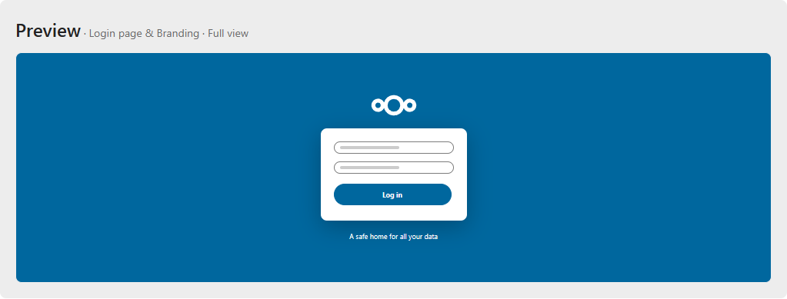
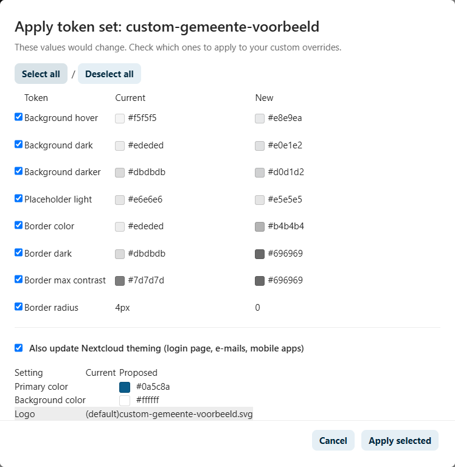

# Preview and apply a theme

## Look before you switch

The **Preview** under **Custom token overrides** is a small model of Nextcloud in the current theme. Use the tabs above it to look at different parts:

- **Login page & Branding** shows the login page.
- **Content area**, **Buttons & Status** and **Typography** show the app screens, with dialogs, buttons and text.
- **Your components** shows the components of the apps you use.

## Apply a theme

1. In the **Design token set** list at the top of the section, pick a theme. Type part of its name in **Search by name** to find it quickly.
2. The **Apply token set** dialog opens. It lists every value that changes, with its **Current** and **New** value. Untick a row to keep its current value; **Select all** and **Deselect all** tick or untick every row.
3. Leave **Also update Nextcloud theming (login page, e-mails, mobile apps)** ticked. Thematiq then also copies the theme's primary colour, background colour and logo into Nextcloud's own theming, so the login page, emails and the mobile apps follow.
4. Click **Apply selected**. Everyone sees the new theme on their next page.

**Cancel** changes nothing: the list goes back to the theme that was active.

:::note House styles of other organisations
The themes of municipalities and other organisations belong to them. Before you can apply one, open it under **House styles of other organisations**, read the licence and confirm that your organisation may use it.
:::

## Try a theme in your own session

**Preview in my session** applies the theme in the **Design token set** list to your own session only, so you can walk through Nextcloud with it while your users still see the active theme. A bar with **Publish** and **Discard** stays on the page while the preview runs. **Publish** applies the theme for everyone; **Discard** ends the preview.

## Plan a switch

Under **Planned switches** you can switch to another theme at a set time, for a campaign or a holiday look:

1. Choose the **Token set**, a **Start** time and, if the switch should end by itself, an **End (optional)** time. Times are in your own time zone.
2. Click **Plan switch**.

At the start time the theme is applied as you would apply it yourself, logo and Nextcloud colours included. At the end time the previous theme comes back. Planned switches need Nextcloud's background jobs set to **Cron** (**Administration settings → Basic settings → Background jobs**); with AJAX a switch can start late.

More detail: [Apply dialog](../features/apply-dialog.md), [Theme preview](../features/theme-preview.md) and [Plan a theme switch](../features/plan-a-theme-switch.md).
