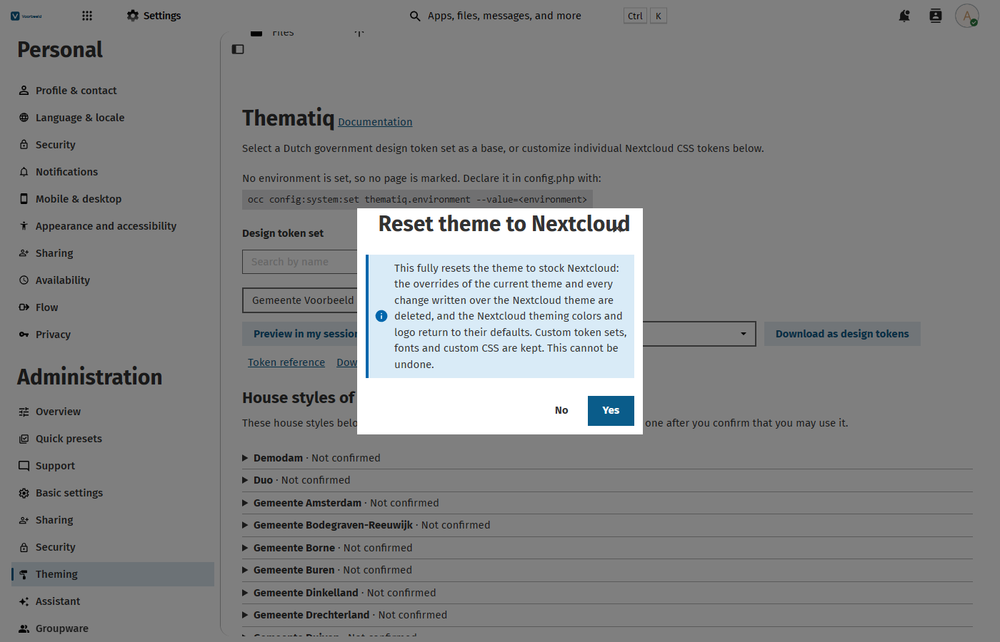

# Undo and reset

## Undo a change

Every theming change is recorded under **Theming audit log**: when, who, what changed, from what and to what. Thematiq keeps the configuration of the last 50 changes (up to 20 MB).

1. Find the change you want to go back to.
2. Click **Restore** on that row.
3. The **Restore this version?** dialog shows what will change. Click **Yes** to restore it; nothing is written before that.

**Download full log** saves the whole log, for example as evidence for an accessibility audit.

## Back to the standard Nextcloud look

1. Click **Reset theme to Nextcloud**, next to the **Design token set** list.
2. Read the message and click **Yes**.

This removes the overrides of the current theme and everything Thematiq wrote into Nextcloud's theming, and puts Nextcloud's colours and logo back to their defaults. Your custom themes, fonts and custom CSS are kept, so you can apply them again later. A reset cannot be undone.

## Delete a custom theme

Under **Your custom token sets**, click **Delete** next to the theme and confirm with **Yes**. If it was the active theme, Nextcloud falls back to its standard look.

More detail: [Restore a version](../features/restore-a-version.md) and [Audit log](../features/audit-log.md).
