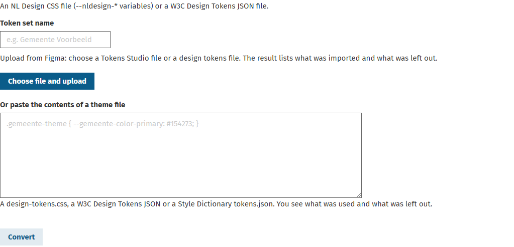

# Upload a theme file

Designers often deliver a brand as a file of design tokens. Thematiq reads these formats:

- an NL Design System `design-tokens.css`, or a CSS file with `--nldesign-*` variables;
- a W3C Design Tokens JSON file (`.tokens.json`) or a Style Dictionary `tokens.json`;
- a Tokens Studio for Figma export.

## Step 1 — Open the form

Go to **Administration settings → Theming**, scroll to **Custom token sets** and stay on the **Upload a file** tab.

## Step 2 — Add the file

1. Type a **Token set name**, for example *Gemeente Voorbeeld*.
2. Then either:
   - click **Choose file and upload** and pick the file, or
   - paste the file's contents into **Or paste the contents of a theme file** and click **Convert**.

Thematiq then shows what it used and what it left out. Tokens that Nextcloud has no place for are left out; that is normal.

## Step 3 — Apply it

The theme is now listed under **Your custom token sets** and in the **Design token set** list. Apply it as described in [Preview and apply a theme](./preview-and-apply.md).

Each theme in **Your custom token sets** has **Download**, **Download as design tokens** and **Delete**. Use **Download as design tokens** to hand the theme back to your designers in the format chosen in the list next to it, such as *W3C design tokens* or *Figma variables*.

More detail: [Custom token sets](../features/custom-token-sets.md) and [Figma tokens](../features/figma-tokens.md).
